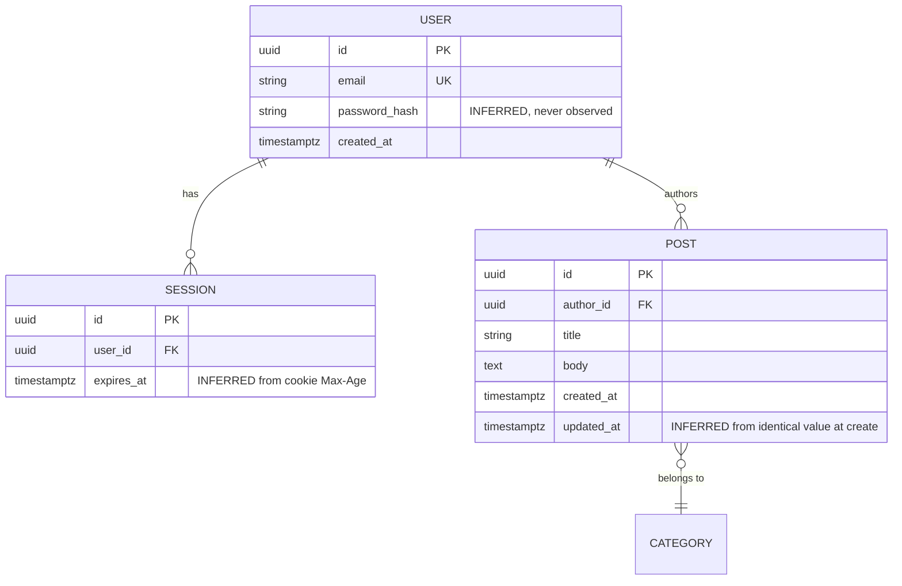
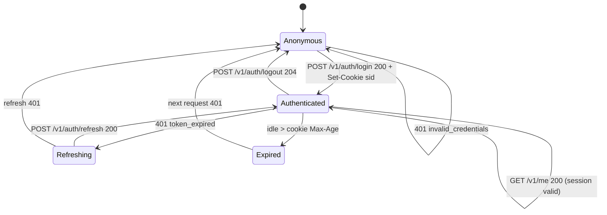
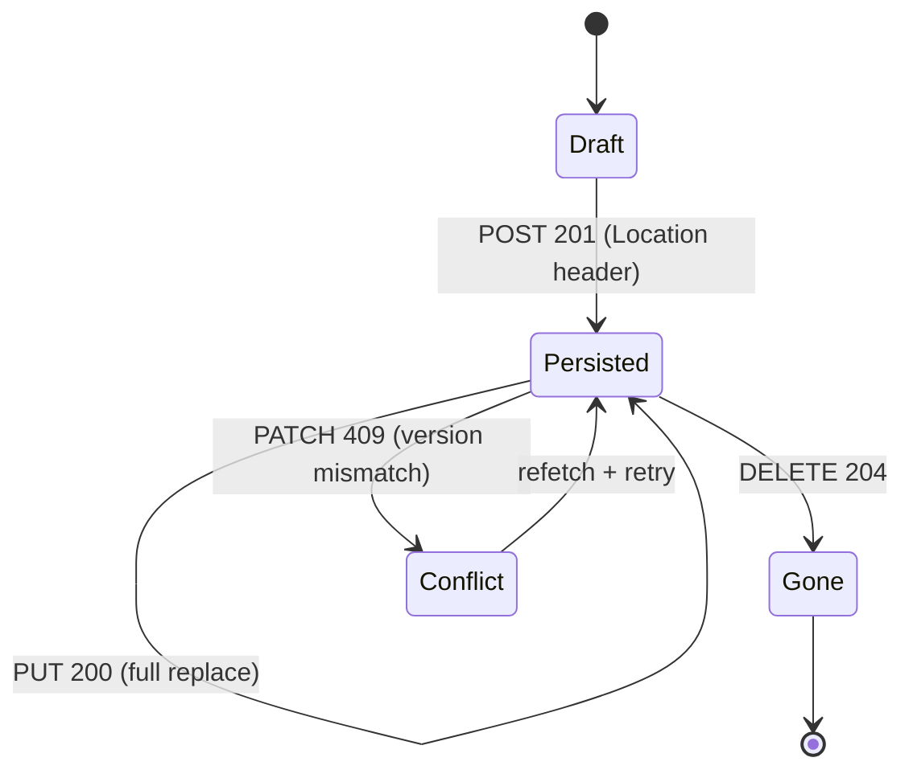
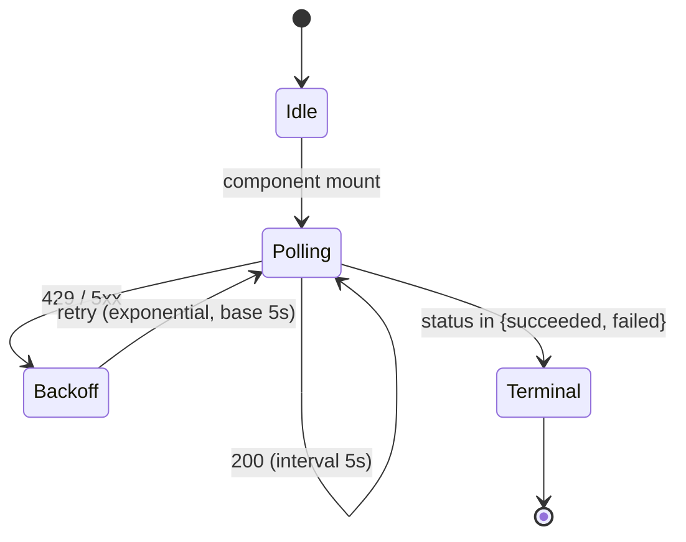
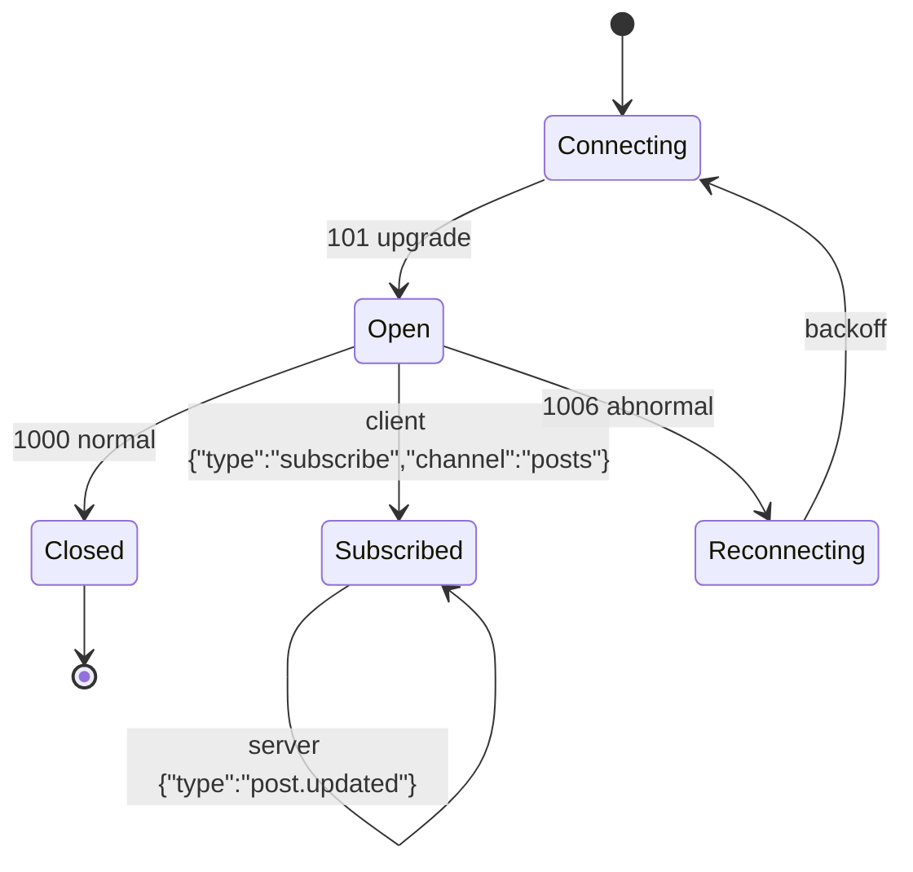

# Architecture Dossier — `<TARGET NAME>`

> Copy this file to `recon/architecture.md` and fill every section. Delete instruction
> blockquotes as you go, and keep the provenance labels. This document is the bridge between
> what the browser showed you (`OBSERVED`) and the server you are about to write
> (`INFERRED`). Anything you cannot ground in a capture stays `UNKNOWN` — an empty,
> honest row is worth more than a confident guess.

## Provenance legend

| Label | Use it for | Evidence required |
|---|---|---|
| `OBSERVED` | A request, response, status, header, frame or payload you actually captured | `har:<index>` / `ws:<index>` / `sse:<index>` |
| `DERIVED` | A value computed from captures by `scripts/parse_har.py` | parser output field, e.g. `endpoints.json#GET /v1/users/{user_id}` |
| `INFERRED` | Your reasoning about server behaviour you could not see | the observation it rests on **and** a test that could falsify it |
| `UNKNOWN` | Not determinable from client traffic | none — leave blank, do not fill |

Confidence scale for `INFERRED` rows: `high` (multiple consistent observations),
`medium` (one observation, plausible mechanism), `low` (single weak signal, could be a
client-side artifact).

---

## 1. Scope and provenance

| Field | Value |
|---|---|
| Target origin(s) | `<https://app.example.com>` |
| Capture date / tool version | `<ISO date>` / `backend-cloner 1.0.0` |
| Authorization basis | `<owner / written permission / own session, per SKILL.md Rule 1>` |
| Accounts used | `<test account id, never a credential>` |
| Journeys captured | `<sign-in, list, detail, create, update, delete, search, sign-out>` |
| Journeys **not** captured | `<admin, billing, invite, background jobs>` |
| Raw capture location | `recon/capture/` (sensitive, gitignored, never shared unmasked) |
| Input hashes | `network.har sha256:<…>` |

## 2. Observed API contracts

One row per operation from `recon/distilled/endpoints.json`. This table is the only place
where you may describe the server with full confidence — do not add rows that lack a HAR
entry index.

| # | Method | Path template | Auth | Req content type | Response status(es) | Resp schema (component) | Evidence | Notes |
|---|---|---|---|---|---|---|---|---|
| 1 | `POST` | `/v1/auth/login` | none | `application/json` | `200`, `401` | `LoginResponse` | `har:3,4` | sets `Set-Cookie: sid` |
| 2 | `GET` | `/v1/users/{user_id}` | bearer | — | `200`, `404` | `UserResponse` | `har:9` | |
| 3 | `GET` | `/v1/users` | bearer | — | `200` | `UserListResponse` | `har:11` | `?page=&per_page=` |

**Captured request headers that matter** (drop the rest): `<Authorization: Bearer …>`,
`<X-Request-Id>`, `<Accept-Language>`, `<Content-Type>`.

**Captured response headers that matter**: `<Content-Type>`, `<Cache-Control>`,
`<X-RateLimit-*>` if present, `<Set-Cookie>` flags observed (`HttpOnly`, `SameSite`, `Secure`).

**Error envelope** (`OBSERVED` if captured, else `INFERRED`):

```json
{ "error": { "code": "string", "message": "string", "details": {} } }
```

## 3. Endpoint-level unknowns

List the gaps explicitly instead of designing around them silently.

| Question the client could not answer | Status | Consequence for the rebuild |
|---|---|---|
| Soft vs. hard delete on `DELETE /v1/users/{user_id}` | `UNKNOWN` | implement soft delete, document the assumption |
| Whether list endpoints are cursor- or offset-paginated beyond page 2 | `UNKNOWN` | support the observed `page` param only |
| Real rate limits | `UNKNOWN` | implement permissive defaults, note as non-parity |
| Server-side uniqueness constraints | `INFERRED` `medium` from `409` on duplicate email | add unique index on `email` |

## 4. Entity-Relationship model

The client never sees tables. Every entity below is `INFERRED` from payload shape,
identifier style and relationship hints — never `OBSERVED`.



### 4.1 Attribute ledger

Every column needs a source. `password_hash` is the archetype of a field that exists
because the login contract requires it, not because you saw it.

| Entity | Attribute | Type | Null | Provenance | Source / reasoning |
|---|---|---|---|---|---|
| `USER` | `id` | `uuid` | no | `DERIVED` | `id` field format across 12 payloads |
| `USER` | `email` | `text` | no | `OBSERVED` | present in every user payload |
| `USER` | `password_hash` | `text` | no | `INFERRED` `high` | `POST /v1/auth/login` verifies a secret; storage mechanism unobserved |
| `USER` | `display_name` | `text` | yes | `OBSERVED` | `null` seen for 3 of 12 users |
| `POST` | `updated_at` | `timestamptz` | no | `INFERRED` `medium` | equals `created_at` in create response, differs after PATCH |
| `POST` | `deleted_at` | `timestamptz` | yes | `UNKNOWN` | no delete flow captured |

### 4.2 Relationship ledger

| From | To | Cardinality | Provenance | Reasoning |
|---|---|---|---|---|
| `USER` | `POST` | 1:N | `INFERRED` `high` | `author_id` on posts; `/v1/users/{id}/posts` exists |
| `POST` | `CATEGORY` | N:1 | `INFERRED` `medium` | `category_id` never null in captures; no category CRUD observed |

### 4.3 Storage decisions (yours, not theirs)

State choices and why: `<PostgreSQL 16; UUIDv7 primary keys; timestamptz UTC; soft delete
via deleted_at; unique index on lower(email); FK ON DELETE RESTRICT>`. These are design
decisions, not reconstructed facts — label them `DESIGN`.

## 5. State machines

One diagram per flow that the capture actually exercised. Mark the transitions you did not
observe with `UNKNOWN` in the accompanying table rather than drawing them as facts.

### 5.1 Authentication



| Transition | Trigger | Provenance | Notes |
|---|---|---|---|
| `Anonymous → Authenticated` | login 200 + cookie | `OBSERVED` `har:3` | token also returned in body for mobile clients |
| `Authenticated → Refreshing` | 401 with `code=token_expired` | `OBSERVED` `har:41,42` | retry happens once, then gives up |
| `Refreshing → Authenticated` | refresh 200 | `OBSERVED` `har:43` | new `sid` cookie issued |
| Session revocation on logout | logout 204 | `INFERRED` `medium` | server-side invalidation unobservable; test with replayed cookie |

### 5.2 CRUD lifecycle



| Transition | Trigger | Provenance |
|---|---|---|
| `Draft → Persisted` | `201` + `Location: /v1/posts/{id}` | `OBSERVED` |
| `Persisted → Conflict` | `409` on stale `updated_at` | `INFERRED` `low` — only one 409 captured, cause ambiguous |

### 5.3 Polling



| Parameter | Observed value | Provenance |
|---|---|---|
| Interval | `5000 ms` between `GET /v1/jobs/{id}` | `OBSERVED` (HAR `startedDateTime` delta) |
| Backoff | `UNKNOWN` | not exercised |
| Terminal condition | `status` field stops changing | `DERIVED` |

### 5.4 Realtime / webhooks



| Message | Direction | Schema | Provenance |
|---|---|---|---|
| `{"type":"subscribe","channel":"posts"}` | client → server | `{type, channel}` | `OBSERVED` `ws:0` |
| `{"type":"post.updated","data":{…}}` | server → client | `{type, data: Post}` | `OBSERVED` `ws:4` |

**Webhooks**: if the client never receives one, they are `UNKNOWN`. Do not invent callback
payloads; note that the server must emit them and leave the shape `UNKNOWN`.

## 6. Server-side logic hypotheses

Each hypothesis needs an observation and a falsifying test. This is where `INFERRED` earns
its keep.

| # | Hypothesis | Rests on | Confidence | Falsified if |
|---|---|---|---|---|
| H1 | Emails are unique and case-insensitive | `409` on second signup with same email, different case | `high` | a second signup succeeds |
| H2 | List default page size is 20 | 20 items returned when `per_page` absent | `high` | a 21-item list appears without the param |
| H3 | `updated_at` is server-set, clients cannot set it | `PATCH` sending `updated_at` returns the server's value | `medium` | echoed value differs |
| H4 | Deletes are soft, rows persist for 30 days | `404` after delete while `id` still referenced elsewhere | `low` | `410 Gone` observed instead |

## 7. Non-functional behaviour

| Aspect | Observed | Inference |
|---|---|---|
| Rate limiting | `<X-RateLimit-Remaining>` seen | limits `UNKNOWN`; implement `60/min` per token as a documented design choice |
| Caching | `<Cache-Control: private, max-age=0>` | no shared cache; ETags `UNKNOWN` |
| Idempotency | no `Idempotency-Key` header seen | retries may duplicate writes; document as `UNKNOWN` |
| Compression | `<Content-Encoding: gzip>` | enable gzip/br |
| CORS | `<Access-Control-Allow-Origin>` absent (same-origin app) | same-origin only unless user asks |
| Time format | ISO 8601 UTC with `Z` | store `timestamptz`, serialize UTC |

## 8. Implementation plan

| Spec area | Module (yours) | Notes |
|---|---|---|
| Auth | `app/auth/` | own hashing + own token issuance, matching the *observed* scheme |
| Users | `app/users/` | routes, service, repository |
| Posts | `app/posts/` | |
| Realtime | `app/realtime/` | WebSocket fan-out; channels from §5.4 |
| Persistence | `alembic/` | migrations build from empty; no dump import |
| Seed | `scripts/seed.py` | **synthetic** rows matching observed shapes |

Endpoint coverage checklist: every operation in `recon/openapi.yaml` → one route, one
request validator, one response serializer, one parity test. Do not implement
`x-inferred-routes` as if they were contracts — either implement them behind a documented
assumption or list them as not implemented.

## 9. Deliberate deviations

Anything where you chose different behaviour, and why. Deviations are allowed; silent
deviations are not.

| Area | Observed | Rebuild | Reason |
|---|---|---|---|
| Rate limit | unknown | 60/min per token | abuse protection, documented as non-parity |
| IDs | uuid v4 | uuid v7 | ordered index locality; wire format unchanged |

## 10. Parity and test plan

| Observed contract | Test | Fixture | Expected |
|---|---|---|---|
| `POST /v1/auth/login` 200 | `test_login_sets_session_cookie` | sanitized `har:3` | `200`, `sid` cookie, `HttpOnly` |
| `POST /v1/auth/login` 401 | `test_login_rejects_bad_password` | `har:4` | `401`, error envelope §2 |
| `GET /v1/users/{id}` 404 | `test_unknown_user_404` | `har:10` | `404` + same envelope |
| `GET /v1/users?page=2` | `test_list_pagination` | `har:12` | 20 items, `page` echoed |

Coverage summary to report honestly:

- Captured and verified: `<n>` operations
- Inferred-only, implemented under assumption: `<n>` operations
- Not implemented (`UNKNOWN`): `<n>` operations
